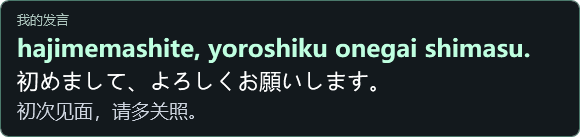
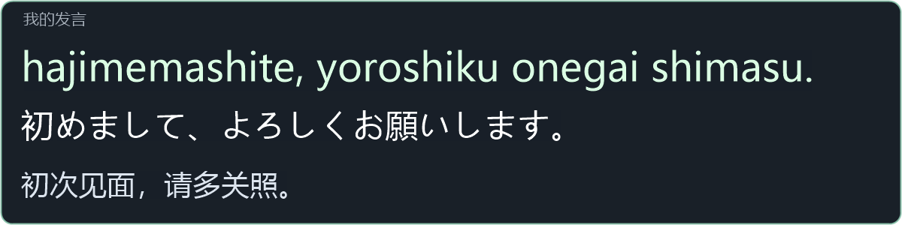

# VRCLS 日语交流补丁：把你说的话变成可以照着读的日语

对着麦克风说「初次见面，请多关照」。VRCLS 译成日语后，**电脑桌面和 SteamVR 头显**各有一个「我的发言」小窗。第一行是可以照着念的罗马音，第二行是日语译文，第三行是你刚说的原话。和日本人聊天时，即使对方已经接话，你仍然可以把自己的这句话读完。小窗只在你再次发言时换句。

**电脑上**，照常打开官方 VRCLS，小窗会出现在主字幕窗上方。拖动「我的发言」标题可移动位置。长句会换行，超过窗口高度可用滚轮查看。PC 主字幕列表使用官方行距，罗马音集中在小窗显示。只用电脑时也可以使用。

上图是 PC 小窗用示例句生成的实际画面。

要把中文直接发到 VRChat，在 **设置 → 语音识别 → 麦克风识别** 打开 **只发送我说的原文**。例如，说「等我一下」，聊天框就显示「等我一下」。关闭开关即可恢复麦克风翻译。

麦克风设为「常开（实时识别）」时，**按住键盘 V 暂停翻译收音，松开恢复**，在 VRChat 窗口里也可以使用。Quest 左手柄 X 同样可以暂停翻译收音。两键都按住时，要等两个都松开才会恢复。对方的桌面声音仍可翻译。

**头显里**，开启 SteamVR 字幕后，在主字幕上方看「我的发言」。

补丁的小窗渲染器使用示例句生成的实际面板画面；图中只展示小窗，不是头显全景。

**这是装在官方 VRCLS 上的补丁。** 装好后照常打开原来的 VRCLS 或 SteamVR 入口，不需要另外启动程序。

[下载 Windows 补丁 ZIP](https://github.com/pan0001/VRCLS-Romaji/releases/download/v1.3.0/VRCLS-Romaji-Patch-windows-x64.zip) · [安装、使用和卸载说明](romaji/Patch/README.md)

首次使用：退出 VRCLS（包括托盘），解压 ZIP 并运行 `Install-Patch.cmd`。再打开官方 VRCLS，把麦克风的目标语言设为日语。在头显中使用时，另开启 SteamVR 字幕。

使用 Quest 时，按住左手柄 X 会暂时停止翻译程序收音，松开恢复。兼容的官方更新可以在 VRCLS 退出后自动补回补丁。

本项目是 [VoiceLinkVR/VRCLS](https://github.com/VoiceLinkVR/VRCLS) 的非官方补丁。
