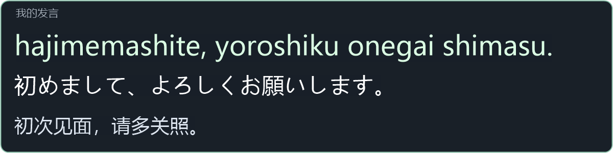

# VRCLS 日语交流补丁 · 安装与使用

对着麦克风说「初次见面，请多关照」。VRCLS 译成日语后，**电脑桌面和 SteamVR 头显**各有一个「我的发言」小窗。第一行是可以照着念的罗马音，第二行是日语译文，第三行是你刚说的原话。和日本人聊天时，即使对方已经接话，你仍然可以把自己的这句话读完。小窗只在你再次发言时换句。

**电脑上**，照常打开官方 VRCLS，小窗会出现在主字幕窗上方。拖动「我的发言」标题可移动位置。长句会换行，超过窗口高度可用滚轮查看。PC 主字幕列表使用官方行距，罗马音集中在小窗显示。只用电脑时也可以使用。

上图是 PC 小窗用示例句生成的实际画面。

**头显里**，开启 SteamVR 字幕后，在主字幕上方看「我的发言」。

补丁的小窗渲染器使用示例句生成的实际面板画面；图中只展示小窗，不是头显全景。

还没说话时，小窗是什么样子？

这是从实际运行的 SteamVR 读取的小窗画面。开启字幕但还没有麦克风译文时，会显示「等待你的发言…」。

## 安装并试说一句

1. [下载 Windows x64 补丁 ZIP](https://github.com/pan0001/VRCLS-Romaji/releases/download/v1.2.0/VRCLS-Romaji-Patch-windows-x64.zip)，完整解压。
2. 退出官方 VRCLS，包括托盘图标，然后双击 `Install-Patch.cmd`。首次安装会从本机缓存或 NuGet 获取并校验日语词典等依赖。
3. 照常打开官方 VRCLS，把**麦克风目标语言设为日语**。对着麦克风说「初次见面，请多关照」，在 PC 小窗照着第一行读。要在头显里看，再开启 SteamVR 字幕。

小窗按麦克风通道判断哪些是「你说的话」。Quest 左手柄按住 X 可暂停翻译收音，松开恢复；VRChat 自己的麦克风不受影响。

## 更新或卸载

兼容的官方更新完成后，后台修复工具会等 VRCLS 退出、文件稳定后自动补回。如果更新器直接打开了新版，请正常退出一次，等检查完成再打开。遇到不兼容的版本不会写入，需要等待适配。状态记录在 `%LOCALAPPDATA%\VRCLS-Romaji-Patch\status.txt`。

要卸载，先退出 VRCLS，再双击 `Uninstall-Patch.cmd`。它会停用自动修复，恢复匹配的官方文件。账号和设置不受影响。

如果 VRCLS 装在别的位置，在解压目录用 PowerShell 运行：

~~~powershell
powershell -NoProfile -ExecutionPolicy Bypass -File .\Setup.ps1 -InstallDir "D:\VRCLS"
~~~

加 `-ManualOnly` 可不启用后台修复。本次适配的官方版本为 VRCLS 0.7.0.1017，保留对 0.7.0.1015 的支持。曾使用 v1.0 启动器的用户，改从官方 VRCLS 打开，并在其设置中重新注册 SteamVR 自动启动。
