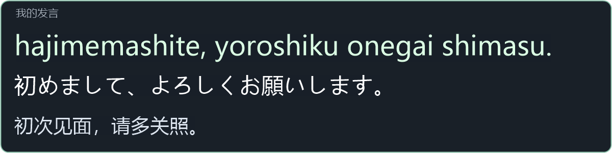

# VRCLS Romaji · 官方 VRCLS 的日语交流补丁

你说中文后，SteamVR 会用一个独立小窗保留你的日语译文，并把罗马音放在最上方。别人说话时它也不会滚走，方便你照着读日语。

补丁的小窗渲染器使用示例句生成的实际面板画面；图中只展示小窗，不是头显全景。

[下载原位补丁](https://github.com/pan0001/VRCLS-Romaji/releases/download/v1.1.1/VRCLS-Romaji-Patch-windows-x64.zip) · [查看安装教程](Patch/README.md)

开发者：在仓库根目录使用 `.\romaji\Build.ps1` 构建。历史 v1.0 模式见[旧版说明](Launcher/README.md)，使用当前补丁不需要它。
